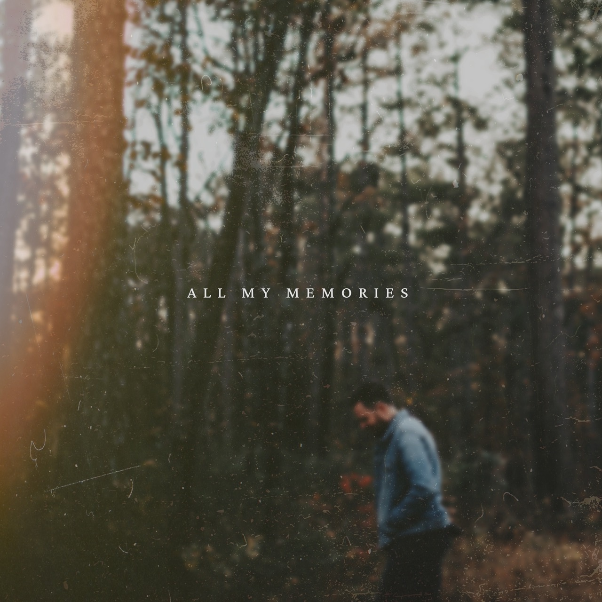
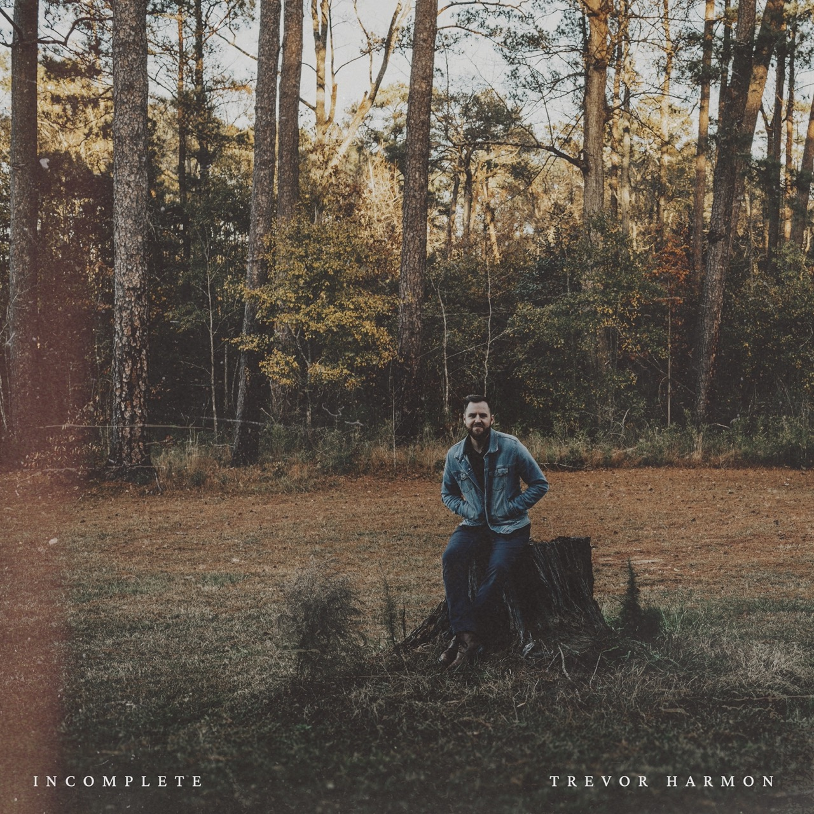
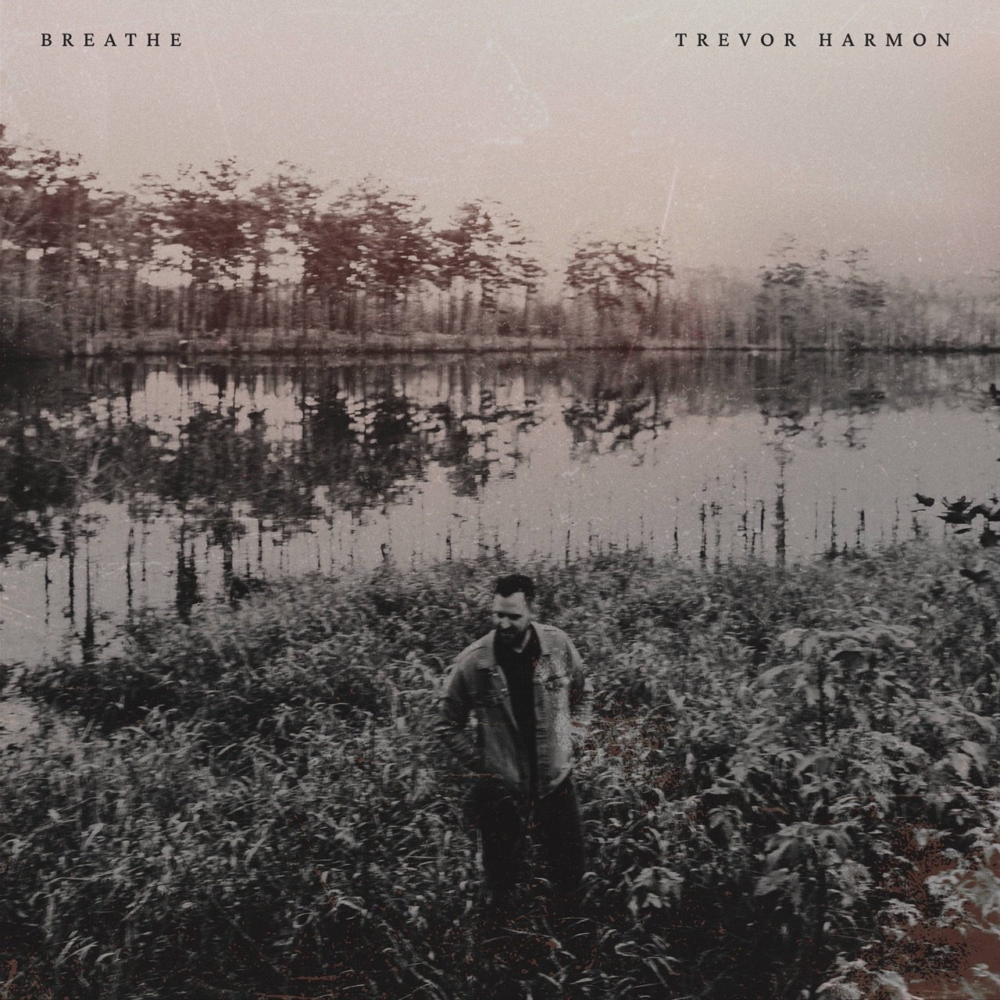
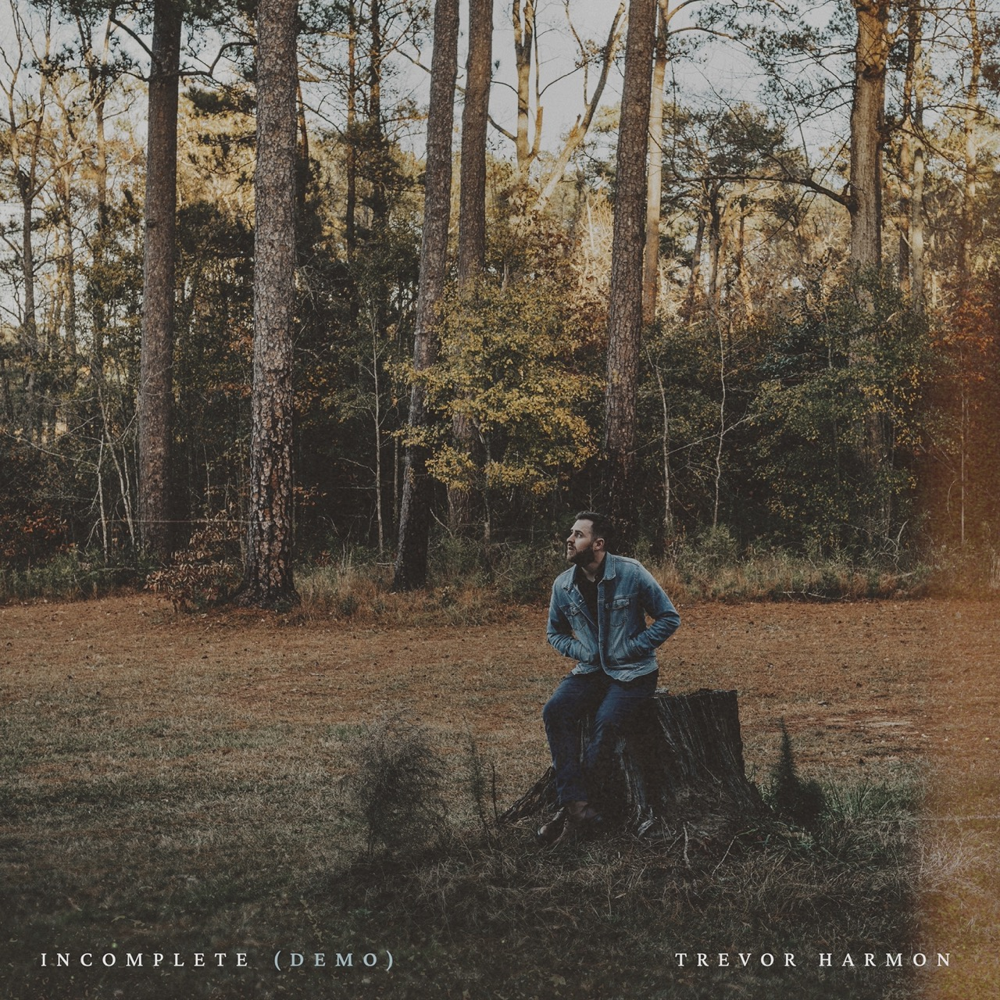
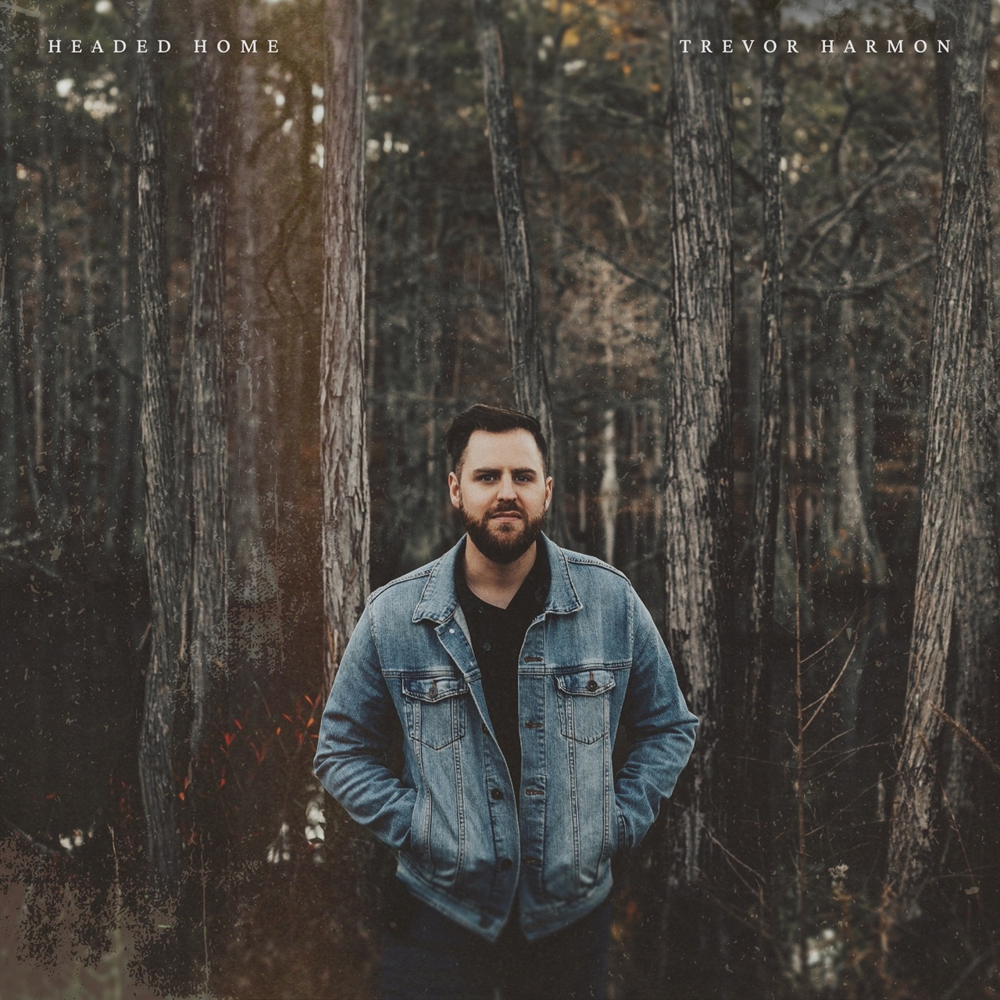
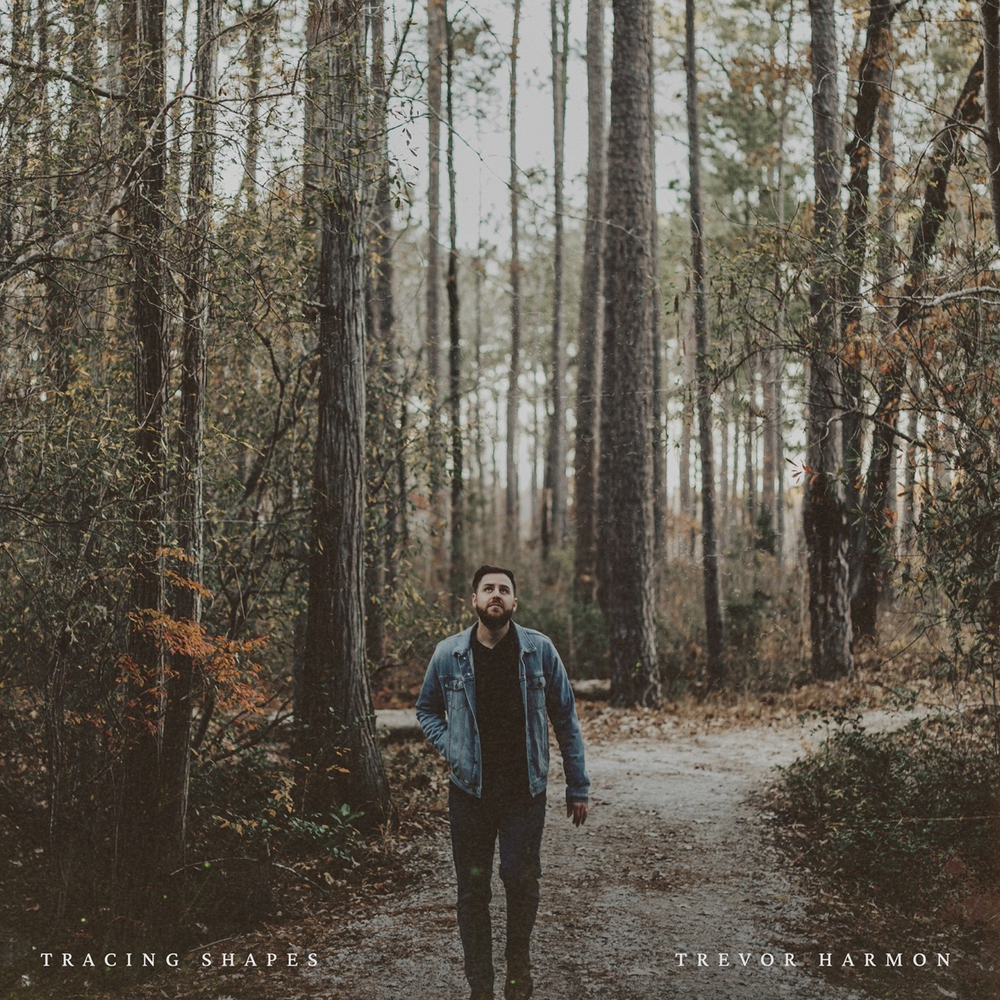
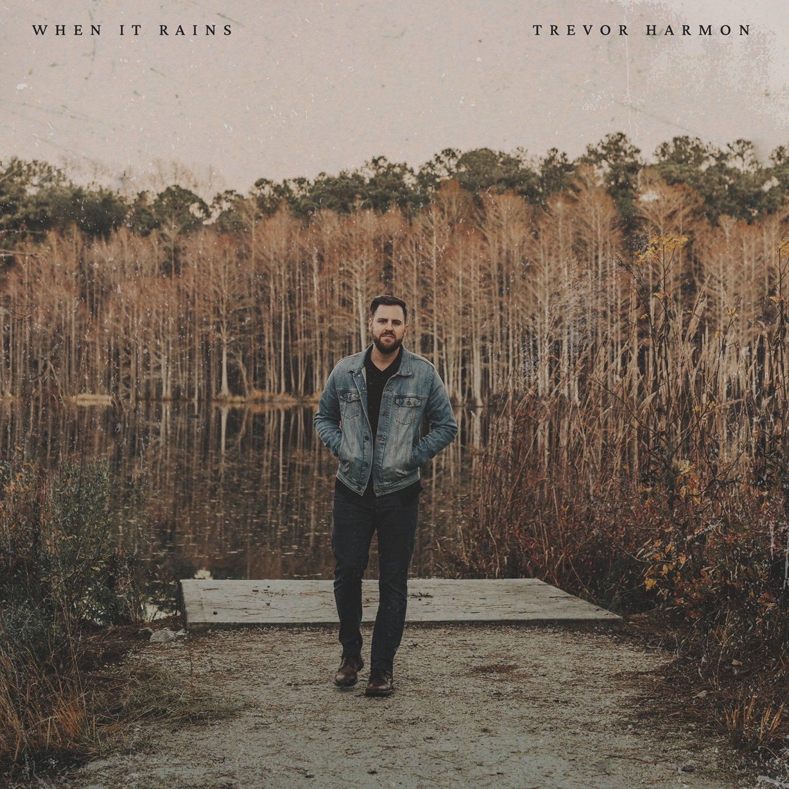
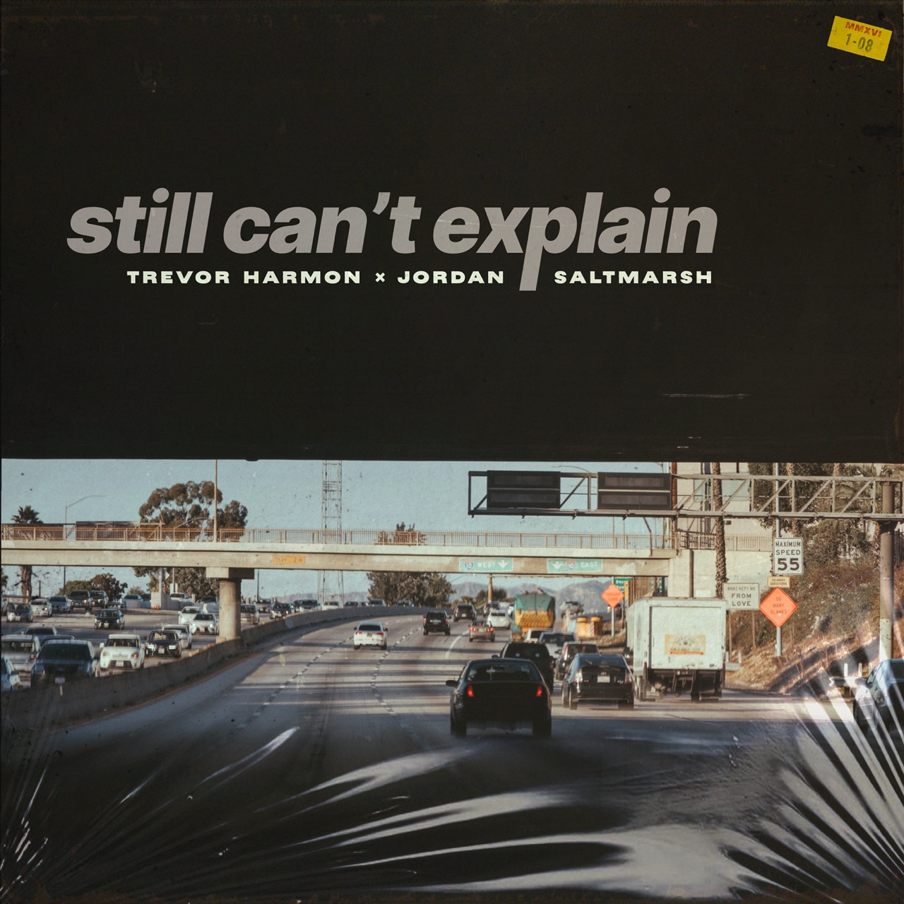
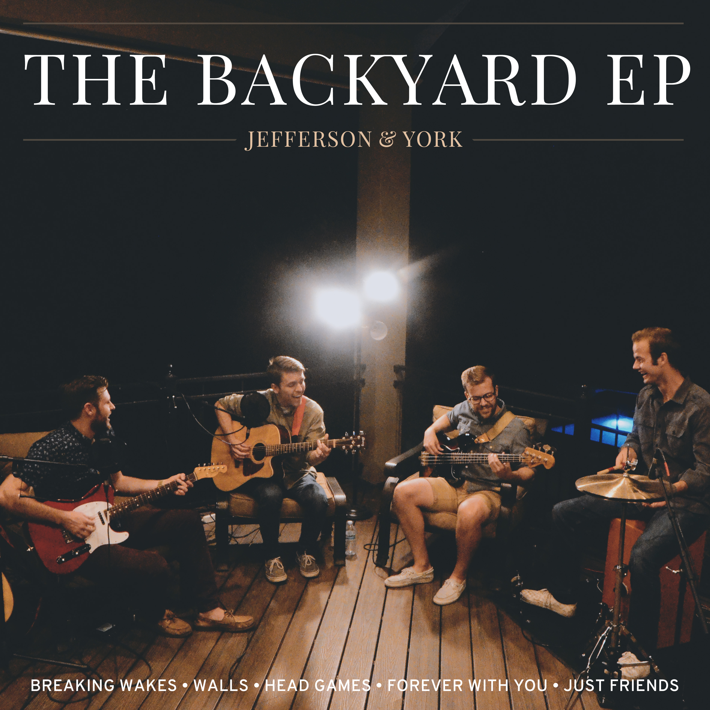

I've been writing and recording music since I was 15. Not all the music was particularly _good_ music, but it's been a lot of fun throughout the many years I've been pursuing it as a hobby. My [about page](/about/#music) has a chronological list of the music groups I've been in or associated with, and with many of those groups, I was the principle designer for any visual content. Much of the content I produced was for Michael Barrow & the Tourists, and I opted to include that as its [own post](/blog/designing-for-michael-barrow-and-the-tourists/). This post is "everything else" that didn't fit in that post.

<Callout>
The album artwork I have included here is not necessarily a comprehensive look at what I've created, just the stuff I actually feel a measure of pride or sentimentality about.
</Callout>

## Personal Music

### All My Memories (2024)

In 2024 I released [All My Memories](https://open.spotify.com/album/6KikvfG00A2KQBXJdYUKZb?si=1lKwQcCLShqNkTk_QXO5tg). The original plan for this album was to release all of the songs as singles and then combine them into a single release as an EP. While I didn't go through with that release plan, I _did_ produce all of the album artwork for them as if they were singles.

The cover of the EP that was released:

<Breakout>
  
</Breakout>

I ended up releasing three singles: _Breathe_, _Incomplete_, and _Incomplete (Demo)_. The cover for _Incomplete_ was originally going to be the cover of the EP.

<Breakout>
  

  <TwoUp>
    
    
  </TwoUp>
</Breakout>

The three singles that weren't released individually were _Headed Home_ (title track), _Tracing Shapes_, and _When It Rains_.

<Breakout>
  

  <TwoUp>
    
    
  </TwoUp>
</Breakout>

These album covers are a good example of "it's harder than it looks". I went through probably 30-35 different fonts and 15 different text positioning ideas to land where I finally landed–and I didn't even end up using three of them! Overall I feel proud of these covers and I feel like I did a good job designing covers that matched the vibe of the music.

### Still Can't Explain (2022)

I designed this album cover for my single _Still Can't Explain_. The song feels like a "driving song" to me, and I drew on my time in Los Angeles as an inspiration for the album cover. The picture is of the 405 in LA (which was the closest freeway to our apartment). I left a bunch of easter eggs throughout the album art, some that were very obscure:

- There is a street sign that says "what kept me from love", a lyric from the chorus.
- There are two street signs on the same pole that read "so many questions" and "so many blanks", lyrics from the second verse.
- The sticker at the top reads `MMXVI 1-08`–this is a reference to the date of the breakup that inspired the song (2016-01-08).

It was a fun time making this album art and adding in these easter eggs, even if I was the only one who knew about them.

<Breakout>

</Breakout>

## Jefferson & York

### The Backyard EP (2015)

_The Backyard EP_ is a 5-song EP that we recorded on the back porch of a friend of ours. We recorded the EP and then the lead singer immediately moved to Washington DC for an internship. A friend of ours captured video and photos, and I ended up using a photo from the session as the album art.

<Breakout>

</Breakout>

### Unplugged (2014)

_Unplugged_ was the first EP that Jefferson & York released. Jordan Gundersen (middle) and I recorded it in my living room over Christmas break. Then by the time we were about to release it, we had added Jordan Saltmarsh (right) to the group–so while he never played on the EP, we included him in the artwork. I had an idea to make the words appear as if they were laid across our t-shirt, and we asked a photographer friend for some pictures as a favor.

<Breakout>

</Breakout>